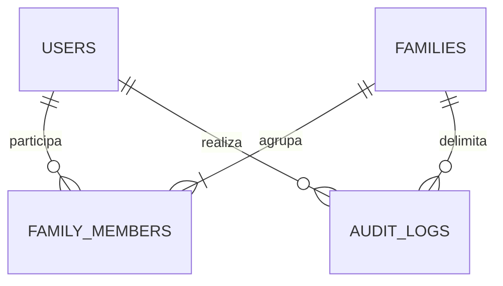
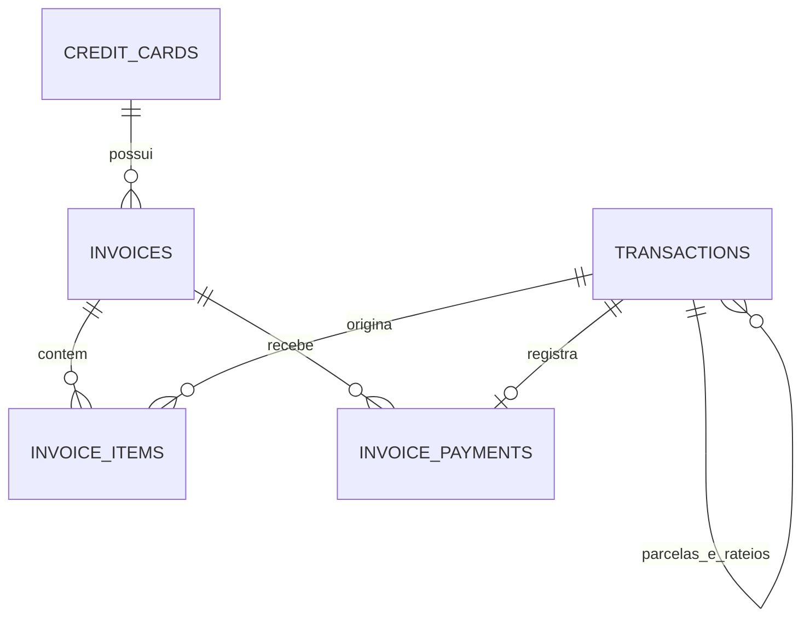
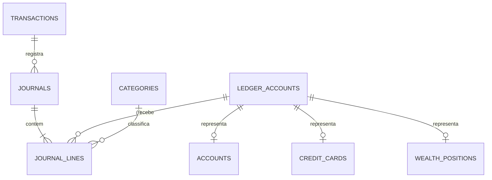

# SisFin — arquitetura e implementação da API

**Versão:** 1.0.0 · **Stack:** Python 3.12+ / FastAPI / Pydantic V2 / PostgreSQL 16 / SQLAlchemy 2.0 assíncrono / asyncpg / Alembic / JWT / bcrypt.

A especificação foi construída a partir do esboço fornecido e das quatro entregas técnicas solicitadas. O código está no projeto `sisfin`, com dependências congeladas, configuração Docker e testes. Esta documentação distingue recursos implementados de políticas adotadas e extensões pendentes.

## 1. Modelagem de dados

### 1.1. A regra contábil

O sistema mantém três representações relacionadas, com finalidades diferentes:

| Representação | Fonte | Pergunta respondida |
|---|---|---|
| Fato econômico | `journals` + `journal_lines`, contas de receita/despesa, por `economic_date` | Quanto foi ganho ou consumido na competência? |
| Obrigação | Contas de passivo e auxiliares de faturas/parcelas | Quanto falta pagar e quando vence? |
| Caixa realizado | Linhas do razão vinculadas a `accounts`, por `effective_date` | Quanto entrou/saiu de cada conta real? |

O saldo real **não é um campo editável** em `accounts`. É `SUM(debit-credit)` da respectiva conta contábil. A dívida do cartão é `SUM(credit-debit)` na conta contábil do cartão. Isso elimina caches de saldo/limite que poderiam divergir do histórico.

| Evento de R$ 1.200 | Débito | Crédito | Despesa econômica | Caixa |
|---|---|---|---:|---:|
| Compra no crédito | Despesas | Passivo do cartão | 1.200,00 | 0,00 |
| Pagamento de R$ 100 da fatura | Passivo do cartão | Conta bancária | 0,00 | −100,00 |
| Transferência entre contas | Conta destino | Conta origem | 0,00 | 0,00 consolidado |
| Despesa ainda não paga | Despesas | Contas a pagar | 1.200,00 | 0,00 |
| Liquidação dessa despesa | Contas a pagar | Conta bancária | 0,00 | −1.200,00 |
| Receita ainda não recebida | Contas a receber | Receitas | 0,00 de despesa | 0,00 |
| Recebimento dessa receita | Conta bancária | Contas a receber | 0,00 de nova receita | +1.200,00 |

Em uma compra parcelada, o valor econômico integral é reconhecido na competência informada. As parcelas representam o cronograma da obrigação. Rateios em categorias são outra decomposição da mesma raiz. **Não se soma raiz + parcelas + rateios para medir despesas.** Os relatórios econômicos consultam exclusivamente as linhas de receita/despesa do razão.

Receitas e despesas previstas por recorrência não criam linhas contábeis. A confirmação transforma a previsão em fato. Metas são reservas de valores já existentes, não ativos adicionais.

### 1.2. ERD textual e chaves

Todas as tabelas de domínio possuem `id UUID PK`, `family_id UUID FK` e `created_at TIMESTAMPTZ`. Exceções: `users` e `families` são raízes globais; `family_members` usa PK composta `(family_id,user_id)`. O sufixo **[F]** abaixo significa FK composta `(family_id, campo)` para `(family_id,id)` da tabela relacionada. Nas participações de membros, o destino é `(family_id,user_id)`.

| Tabela / model | Campos e relacionamentos principais | Invariantes e índices |
|---|---|---|
| `users` / `User` | e-mail, nome, hash bcrypt, ativo, versão do token | E-mail minúsculo e único; nunca retornar hash |
| `families` / `Family` | nome, moeda BRL, timezone IANA | Uma moeda funcional nesta versão |
| `family_members` / `FamilyMember` | família FK, usuário FK, papel | PK composta; índice `(user_id,family_id)`; admin/editor/viewer |
| `ledger_accounts` / `LedgerAccount` | família, nome, natureza, chave de sistema opcional | UNIQUE `(family_id,system_key)`; natureza ativo/passivo/PL/receita/despesa |
| `accounts` / `Account` | conta contábil [F], titular [F], tipo, banco, cheque especial, ativa | Uma conta contábil exclusiva; conta corrente/poupança/dinheiro/investimento/carteira |
| `credit_cards` / `CreditCard` | conta contábil [F], titular [F], conta padrão para pagar [F], limite, fechamento, vencimento, quatro dígitos | Limite ≥ 0; dias 1–31; quatro dígitos opcionais; sem número completo/CVV |
| `categories` / `Category` | categoria pai [F], nome, natureza | Pai diferente do próprio ID; serviço exige mesma natureza; árvore só cresce por criação |
| `invoices` / `Invoice` | cartão [F], mês do fechamento, fechamento, vencimento | UNIQUE `(family_id,card_id,cycle_month)`; mês dia 1; fechamento dentro do ciclo; vencimento posterior; índice de vencimento |
| `transactions` / `Transaction` | tipo, nó, status, valor, competência, compra, lançamento da operadora, vencimento, pagamento, conta [F], destino [F], cartão [F], fatura [F], categoria [F], pai [F], original [F], recorrência [F], ator | Valor > 0; raiz sem pai; filhas com pai; parcela com número/fatura/cartão; UNIQUE pai+número e recorrência+ocorrência |
| `invoice_items` / `InvoiceItem` | fatura [F], transação [F], valor com sinal | UNIQUE fatura+transação; valor ≠ 0; crédito de estorno negativo; mesmo cartão no item e fatura |
| `invoice_payments` / `InvoicePayment` | fatura [F], transação de pagamento [F], valor, data | Transação exclusiva; valor > 0; registros imutáveis |
| `cash_settlements` / `CashSettlement` | transação original [F], transação de liquidação [F], valor, data | Permite liquidações parciais; transação de liquidação exclusiva |
| `journals` / `Journal` | transação [F], evento, data econômica e efetiva | UNIQUE transação+evento; índices por família/data |
| `journal_lines` / `JournalLine` | diário [F], conta contábil [F], categoria [F], débito, crédito | Apenas um lado positivo por linha; diário com ≥ 2 linhas e soma zero; índices para saldo e categoria |
| `transaction_shares` / `TransactionShare` | transação [F], participante [F], valor | UNIQUE transação+pessoa; soma das participações = raiz quando informadas |
| `attachments` / `Attachment` | transação [F], nome, URL HTTP(S) | Metadados de comprovantes; API não baixa URLs nem armazena binários |
| `recurrences` / `Recurrence` | natureza, valor/estimativa, frequência, intervalo, início/fim, categoria [F], conta/cartão [F], assinatura/variável/ativa | Conta ou cartão exclusivos; cartão somente despesa a crédito; fim ≥ início |
| `budgets` / `Budget` | categoria [F], mês, valor base, rollover | UNIQUE família+categoria+mês; valor ≥ 0; mês no dia 1 |
| `goals` / `Goal` | conta [F], nome, alvo, prazo, aporte mensal | Alvo > 0, aporte ≥ 0; atual calculado pelas contribuições |
| `goal_contributions` / `GoalContribution` | meta [F], valor assinado, data | Valor ≠ 0; valores negativos liberam reserva; sem lançamento contábil duplicado |
| `wealth_positions` / `WealthPosition` | conta contábil [F], nome, ativo/passivo | Exclusiva; representa patrimônio externo não incluído em contas/cartões |
| `idempotency_records` / `IdempotencyRecord` | família, chave, ator, operação, SHA-256 do corpo, resposta JSONB | UNIQUE família+chave; resposta armazenada no mesmo commit do efeito financeiro |
| `audit_logs` / `AuditLog` | família, ator, tabela, registro, ação, valores anterior/novo JSONB | Imutável; índice `(family_id,created_at)`; dinheiro no JSON como string |

**Dinheiro:** `NUMERIC(12,2)` no banco e `Decimal` no Python. O máximo por campo é R$ 9.999.999.999,99. Entradas com frações de centavo são rejeitadas, não arredondadas silenciosamente. Requisições devem usar strings decimais; respostas também usam strings. Valores de indicadores percentuais são calculados com `Decimal`.

**Isolamento:** as FKs compostas bloqueiam a associação de uma conta, cartão, categoria ou transação de outra família, mesmo que alguém conheça seu UUID. `UNIQUE(family_id,id)` suporta essas referências. As tabelas de domínio têm RLS com `FORCE ROW LEVEL SECURITY`; a API configura a família apenas após verificar associação do usuário. `users`, `families` e `family_members` têm acesso controlado pela camada de autenticação, para permitir essa verificação inicial.

**Índices:** os índices efetivamente criados estão em `schema.sql`: família em cada tabela de domínio, datas econômicas/efetivas, vencimentos, pai/original das transações, categoria/conta contábil, unicidades de ciclos e ocorrências e GIN no array de tags. Não se cria GIN genérico em todos os JSONBs sem uma consulta que o justifique. Busca por descrição/estabelecimento usa `ILIKE` parametrizado; um índice `pg_trgm` é uma evolução conforme volume medido.

### 1.3. Diagramas relacionais

Identidade e auditoria:

Compra, parcelas e faturas:

Razão e saldos:

Planejamento e detalhamento usam as FKs da tabela textual. A separação em diagramas mantém visíveis as relações de cada domínio; o DDL contém as 23 tabelas e todas as FKs.

### 1.4. Restrições além de CHECK

Um `CHECK` por linha não valida sozinho a soma de várias parcelas ou partidas. A migration instala **constraint triggers diferidas até o commit** para validar:

- diário com pelo menos duas linhas e débitos iguais aos créditos;
- soma e quantidade das parcelas compatíveis com a compra;
- soma dos rateios e das participações igual ao valor raiz, quando presentes;
- pai de parcela/rateio sempre raiz.

Outros triggers rejeitam `UPDATE/DELETE` em diários, linhas, pagamentos, itens de fatura, contribuições e auditoria. Linhas só podem ser inseridas em diário criado na mesma transação PostgreSQL. Fatos confirmados não podem ter campos econômicos editados; a data de quitação pode ser atualizada. Correções precisam de eventos compensatórios, preservando histórico.

O fechamento financeiro não depende exclusivamente desses triggers: autorização, saldo disponível, limite de cartão, teto de reembolso e coerência de datas também são verificados nos serviços, sob lock. Escrita direta nas tabelas não é uma interface financeira suportada. `reconciliation.sql` detecta divergência entre auxiliares de cartão e razão.

## 2. Models SQLAlchemy 2.0 e arquitetura Python

`app/models.py` contém os models essenciais solicitados — `User`, `Account`, `CreditCard`, `Invoice`, `Transaction`, `Recurrence`, `Budget`, `Category` — e os auxiliares descritos acima.

Os models usam `DeclarativeBase`, `Mapped[T]`, `mapped_column`, `Numeric`, `JSONB`, `ARRAY`, constraints e FKs compostas. A execução assíncrona está em `app/db.py`, com `create_async_engine(..., isolation_level="READ COMMITTED")` e `async_sessionmaker(expire_on_commit=False)`.

Cada requisição recebe uma `AsyncSession` própria. Não há sessão compartilhada entre tarefas concorrentes nem carregamento preguiçoso de relacionamentos na serialização. A aplicação consulta relações explicitamente e devolve DTOs/Pydantic nos endpoints financeiros principais.

| Camada | Responsabilidade |
|---|---|
| `routers/` | HTTP, dependências de autorização, contratos, status |
| `schemas.py` / `responses.py` | Validação de entrada e contratos OpenAPI |
| `domain.py` | Dinheiro, calendário, parcelas e recorrências sem acesso ao banco |
| `services/finance.py` | Movimentos reais, cartões, obrigações e liquidações |
| `services/planning.py` | Previsões, metas, orçamento e relatórios |
| `services/common.py` | Unidade transacional, locks, idempotência e razão |
| `models.py` / `alembic/` | Persistência, constraints, auditoria e RLS |

O snapshot V1 da migration é independente dos models correntes: a migração **não chama `Base.metadata.create_all()`**. Isso impede que uma alteração futura nos models modifique retroativamente a migration inicial. Não regenerar V1 depois de publicada; alterações devem virar novas revisões.

## 3. Service layer e regras críticas

### 3.1. Compra parcelada no crédito

Implementada em `credit_purchase()`:

1. Validar dinheiro, categoria/rateios, participantes, datas e número de parcelas.
2. Adquirir lock transacional da família; bloquear o cartão com `SELECT FOR UPDATE`.
3. Calcular o saldo devedor no razão e validar limite para o **total** da compra.
4. Criar uma transação raiz ou confirmar uma previsão existente.
5. Converter o total em centavos inteiros; dividir com `divmod` e distribuir o resto nas primeiras parcelas. Nenhuma parcela vale zero.
6. Encontrar o primeiro ciclo pela data de lançamento da operadora, se informada, ou pela data da compra.
7. Criar/obter cada fatura com unicidade família+cartão+ciclo, e gerar a filha de parcela e seu item.
8. Criar filhas de rateio, participações e metadados dos comprovantes.
9. Lançar débito em despesa por categoria e crédito no passivo do cartão, uma única vez pelo total.
10. Persistir o resultado de idempotência e executar commit antes de retornar HTTP 201.

Exemplo: R$ 100,00 / 3 → `33,34`, `33,33`, `33,33`. R$ 1.200,00 / 12 → doze obrigações de R$ 100,00 e R$ 1.200,00 consumidos do limite desde a compra.

**Política de ciclo:** compras no próprio dia de fechamento entram nesse ciclo; depois dele entram no seguinte. `cycle_month` identifica o mês do fechamento. O vencimento é o primeiro dia configurado posterior ao fechamento; pode cair no mês seguinte. Dias inexistentes são limitados ao último dia do mês, preservando a âncora dos próximos meses. Melhor data de compra é o dia posterior ao próximo fechamento real. Não se presume expediente, horário de corte ou feriado específico do banco; `billing_date` permite informar o lançamento efetivo da operadora. Alterações de contrato/calendário do cartão exigem extensão com vigência; a API atual não altera esses dias retroativamente.

### 3.2. Liquidação de fatura

Implementada em `pay_invoice()` e exposta em `POST /invoices/{invoice_id}/payments`:

- bloquear fatura, cartão e conta; validar associação à família;
- calcular `total = SUM(invoice_items.amount)` e `paid = SUM(invoice_payments.amount)`;
- aceitar pagamento positivo até `total-paid`; validar saldo bancário e data;
- criar `Transaction(kind="transfer", details.purpose="invoice_payment")`;
- registrar pagamento e diário `D passivo do cartão / C conta bancária`;
- recalcular limite e estado; guardar idempotência no mesmo commit.

Não é criada linha de despesa. Pagamentos parciais são suportados. Excesso de pagamento é HTTP 409. O limite é liberado exatamente pelo valor efetivamente pago. Antecipação de fatura já constituída é permitida; pagamento anterior aos fatos registrados na fatura não é permitido.

O status da fatura é **derivado**, porque o tempo também altera o status: saldo não positivo → `paid`; saldo positivo após vencimento → `overdue`; pagamento parcial → `partially_paid`; caso contrário `closed` ou `open` conforme o fechamento. O endpoint também retorna valores pagos, pendentes e eventual crédito. Um indicador vencido tem prioridade sobre parcialmente pago.

As parcelas herdam o estado de liquidação da fatura. Não se atribui arbitrariamente um pagamento parcial a determinado estabelecimento. `paid_date` de parcela registra a data da quitação integral da fatura; crédito integral sem pagamento pode quitar o saldo mantendo a data de pagamento nula. Uma cobrança posterior no mesmo ciclo pode reabrir o saldo.

### 3.3. Concorrência, falhas e idempotência

Toda escrita de domínio passa por `atomic()`. O lock consultivo transacional por família serializa operações financeiras desse grupo. É uma escolha conservadora adequada ao volume pessoal/familiar; famílias distintas operam em paralelo. Locks de linhas complementam essa disciplina. Uma evolução para alto volume pode reduzir a granularidade mantendo ordem global de aquisição dos recursos.

`Idempotency-Key` é única na família e vinculada ao ator, à operação e ao hash canônico do corpo. Repetição idêntica devolve o resultado original. Reuso com dados/rota/ator diferentes retorna 409. Não há expiração automática da chave nesta versão; arquivamento deve preservar proteção contra repetição. Falha de saldo, limite, flush ou commit desfaz também parcelas, faturas novas e registro de idempotência. Nenhum sucesso HTTP é devolvido antes da confirmação do commit.

### 3.4. Outras regras implementadas

**Conta e transferência.** Abertura e ajustes usam contrapartida em patrimônio líquido, com motivo. Ajustes não aparecem como renda operacional. Transferência debita a conta destino e credita a origem em um mesmo diário. Saldo insuficiente e débito retroativo que produziria saldo histórico negativo são rejeitados quando não há autorização de cheque especial.

**Receita/despesa em conta.** O reconhecimento cria contas a receber/pagar; o recebimento/pagamento baixa essa obrigação. `payment_date` na criação permite reconhecimento e liquidação na mesma requisição. Datas de competência, compra, vencimento e pagamento permanecem distintas. Adiantamentos anteriores à competência não são implementados e retornam 422.

**Reembolso/estorno.** Ambos apontam para a despesa original e reduzem a despesa líquida da categoria. Reembolso de terceiro entra em conta real. Estorno pode entrar na conta ou creditar uma fatura do mesmo cartão. A soma devolvida por categoria não pode exceder o gasto líquido original. Em despesa de conta, também não pode exceder o desembolso já liquidado. Compra dividida exige indicar qual categoria está sendo devolvida. Não se apaga nem se sobrescreve a despesa original.

**Crédito de fatura.** Um estorno após pagamento pode deixar saldo credor. Esse valor aumenta o limite utilizável e é apresentado separadamente; não é projetado como entrada bancária automática. `credit-transfers` realoca o crédito entre faturas do mesmo cartão, por itens de sinais opostos, sem nova despesa, caixa ou lançamento no razão. Não há transferência automática entre ciclos sem confirmação do usuário.

**Recorrências.** Diária, semanal, quinzenal de 14 dias, mensal e anual, com multiplicador `interval` — por exemplo, mensal × 3 = trimestral. A âncora original preserva dia 31 e 29/02 quando retornam ao calendário. Projeção virtual automática em relatórios; materialização opcional e idempotente por ocorrência, sem lançamento no razão. Recorrência variável exige valor confirmado antes da realização. Desativar a regra interrompe novas previsões virtuais; previsões já materializadas precisam de cancelamento explícito.

**Orçamento.** A base é competência e categoria exata, incluindo o total econômico da compra no cartão e deduzindo devoluções. `disponível = base + rollover`; `restante = disponível − despesa líquida`. Se rollover está habilitado no mês atual, transporta o restante do mês imediatamente anterior, positivo ou negativo. Lacuna entre meses reinicia o transporte. Os valores são recalculados pelo razão, inclusive após lançamento retroativo. Não somar categorias pai com filhas como se fossem despesas independentes; rollup hierárquico não é automático nesta versão.

**Metas.** Valor atual é a soma das contribuições/resgates de reserva. Ao alocar, a soma das metas da conta não pode exceder seu saldo. A reserva é organizacional: não bloqueia futuros gastos bancários. A projeção considera aportes mensais constantes, sem rendimento composto. Meta concluída tem previsão hoje; sem aporte e com saldo faltante, a data é nula. Reservas nunca são somadas novamente ao patrimônio.

**Patrimônio.** Soma todos os ativos financeiros, contas a receber e posições externas, descontando passivos, cartões e contas a pagar. Saldo credor de cartão é reclassificado como ativo; conta negativa, como passivo. Posições externas são exclusivas: não cadastrar de novo uma dívida já no cartão nem um investimento já incluído em conta. Avaliações posteriores geram ajustes contra PL; não são receita de salário nem caixa. O endpoint aceita data de corte para consulta histórica.

**Fluxo futuro.** Parte do saldo real atual, adiciona recebíveis/despesas ainda não liquidados e recorrências e deduz faturas abertas. Parcelas já presentes em faturas não são novamente somadas como despesas. Ocorrências existentes, inclusive canceladas, suprimem a previsão virtual correspondente. Compras previstas no cartão entram no vencimento da fatura; créditos compensam cobranças dentro do mesmo ciclo. Vencidos sem baixa são colocados em hoje. O cálculo agrupa por dia e informa o primeiro dia negativo e quais contas ficam negativas, mesmo com saldo familiar positivo. Não presume juros, rendimentos, câmbio ou ordem de pagamentos dentro do dia.

## 4. API REST / OpenAPI

Swagger é gerado em `/docs`; o contrato também acompanha o projeto em `docs/openapi.json`. Datas são ISO 8601, IDs são UUID e dinheiro é string decimal. Listagens principais usam `limit` de até 200 e `offset`. Relatórios são limitados a 1.096 dias por consulta.

| Router | Rotas principais | Acesso |
|---|---|---|
| `/auth` | `POST /register`, `POST /token`, `GET /me`, `POST /logout-all`, `POST /families` | Cadastro/login públicos; demais autenticadas |
| `/accounts` | `GET/POST /`, `GET /{id}`, `POST /{id}/adjustments` | Leitura: membro; escrita: editor/admin |
| `/cards` | `GET/POST /`, `GET /{id}`, `POST /{id}/purchases` | Membro / editor/admin |
| `/transactions` | `GET/POST /`, `GET /{id}`, `POST /transfers`, `POST /{id}/settlements`, `/refunds`, `/confirm`, `/cancel` | Membro / editor/admin |
| `/invoices` | `GET /`, `GET /{id}`, `POST /{id}/payments`, `POST /{id}/credit-transfers` | Membro / editor/admin |
| `/budgets` | `GET /?month=AAAA-MM-01`, `PUT /` | Membro / editor/admin |
| `/reports` | `GET /economic`, `/cash-flow`, `/net-worth`, `/forecast` | Membro |
| Complementares | `GET/POST /categories`, `/recurrences`, `/goals`, `/positions`; materialização, desativação, contribuições e avaliações | Membro / editor/admin |
| `/families/members` | `GET`, `PUT` | Leitura: membro; alterar papéis: admin |
| `/audit` | `GET` | Admin |

Buscas de transações aceitam competência inicial/final, tipo, status, conta, cartão, categoria, tag e texto de descrição/estabelecimento. Filtrar categoria também encontra raízes que tenham filhas de rateio nessa categoria.

**Autenticação:** OAuth2 Password Bearer, JWT HS256 com algoritmo fixado, `iss`, `aud`, `sub`, `exp`, `iat`, `nbf`, `jti` e versão de token. Hash bcrypt com custo 12; operações de hash/verificação executam em thread para não bloquear o loop assíncrono. Senhas maiores que 72 bytes são rejeitadas explicitamente. Logout global incrementa a versão no banco. O papel familiar é lido no banco, não confiado ao token, e é revalidado após o lock de escrita. Cadastro não atribui acesso a famílias preexistentes. Só admin altera membros, sem remover o último admin.

**Auditoria:** triggers capturam INSERT/UPDATE/DELETE do domínio com ator configurado na transação, timestamp e valores anterior/novo. Os campos de senha/token não entram nessa auditoria. A auditoria financeira é append-only; não constitui, por si só, trilha externa criptograficamente inviolável por administradores do banco.

**Erros:** 401 credenciais; 403 papel/família; 404 recurso não encontrado na família; 409 conflito, saldo, limite ou integridade; 422 formato ou regra de entrada. Erros de integridade não devolvem SQL nem valores de outras famílias.

## Operação e limite da entrega

O README contém comandos de instalação, Docker, migração, autenticação e testes. O pacote não depende de ferramentas do ambiente onde foi produzido. `requirements.lock` registra versões usadas na validação Python. O banco PostgreSQL 16 fica separado da imagem da API. A aplicação não recebe credenciais de superusuário no Compose.

Antes de exposição pública, devem ser configurados TLS, proteção contra abuso no login/cadastro, gerenciamento de segredos, backups com restauração testada e monitoramento. Esses são requisitos de operação do serviço; o projeto entregue não provisiona infraestrutura pública nem afirma homologação de produção. Não há refresh tokens, recuperação de senha, MFA, Open Finance ou envio de notificações nesta versão.

A parte de integração real com PostgreSQL ainda deve ser executada conforme `VALIDACAO.md`. Testes unitários não substituem a comprovação de locks, RLS e constraint triggers no banco.

## Referências técnicas primárias

- SQLAlchemy, AsyncSession e concorrência: https://docs.sqlalchemy.org/en/20/orm/extensions/asyncio.html
- FastAPI, OAuth2 e JWT: https://fastapi.tiangolo.com/tutorial/security/oauth2-jwt/
- PostgreSQL 16, locks explícitos: https://www.postgresql.org/docs/16/explicit-locking.html

As escolhas de reconhecimento integral da compra, ciclo inclusivo no fechamento, granularidade do lock, BRL como moeda única e política de rollover são decisões documentadas deste projeto.
